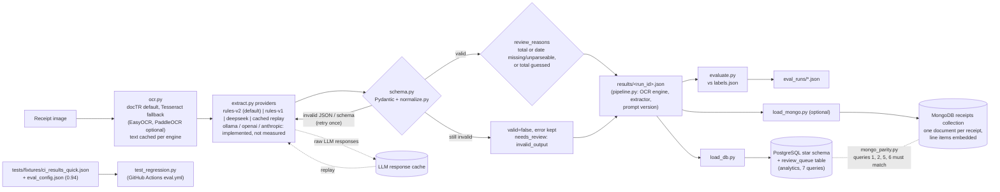

# doc-extraction-eval

**Pulls the merchant, date and total out of scanned receipts (OCR, then a rules-based or LLM extractor), validates every output with Pydantic, and scores each run field by field against a labelled golden set. A regression gate in CI fails the build if accuracy drops below a threshold set from a real run.**

## Why

Teams that use LLMs to read invoices and receipts usually can't tell whether a prompt, model or OCR change made extraction better or worse. I built this to treat extraction like tested software: a fixed golden set, per-field scoring, every run saved with the OCR engine, extractor and prompt version that produced it, a frozen held-out test set, and a CI gate.

## Architecture



- **Stack:** Python 3.11, Pydantic, docTR / Tesseract, PostgreSQL 16, optional MongoDB 7, Docker Compose, GitHub Actions, pytest.
- **OCR:** four engines behind one function, text cached per engine. docTR is the default: one total behind PaddleOCR and about 19× faster in a measured comparison ([docs/RESULTS.md](docs/RESULTS.md)).
- **Extraction:** `rules-v2` (free default), `rules` (frozen rules-v1, kept so old numbers reproduce), `deepseek` (OpenAI-compatible API, temperature 0, JSON mode, key from the environment only), and `cached`, which replays saved raw LLM responses offline and refuses a cache made with a different prompt version. Prompts are in `src/prompts/`.
- **Validation and review:** a failed schema check is retried once, then stored as `valid=false`. Missing or guessed totals and missing dates set `needs_review`.
- **Scoring:** exact match after shared normalization (day-first dates to `YYYY-MM-DD`, totals to 2-decimal strings, merchant casefolded with the company registration number stripped). Fuzzy and post-processed merchant scores are reported separately and never count towards overall or the gate.
- **Storage:** a Postgres star schema with 7 analytics queries, and an optional MongoDB read model checked against it by a parity script ([docs/DOCUMENT_STORE.md](docs/DOCUMENT_STORE.md)).

## Held-out results

**SROIE frozen test set** (`sroie_100`–`299`, 200 receipts, 199 dates scored, docTR 1.1.0). 95% CIs are percentile bootstrap over receipts, 10,000 resamples, seed 20261024 (`scripts/heldout_stats.py`).

| Extractor | Merchant | Date | Total | Overall (micro) | Receipt exact |
|---|---|---|---|---|---|
| rules-v1 | 58.5% [51.5, 65.0] | 96.5% [93.9, 99.0] | 48.0% [41.0, 55.0] | 405/599 **67.6%** [64.5, 70.7] | 47/200 |
| rules-v2 (default) | 58.5% [51.5, 65.0] | 96.5% [93.9, 99.0] | 80.5% [75.0, 85.5] | 470/599 **78.5%** [75.2, 81.7] | 97/200 |
| deepseek extract_v1 | 77.0% [71.0, 83.0] | 98.0% [96.0, 99.5] | 95.0% [92.0, 98.0] | 539/599 **90.0%** [87.6, 92.3] | 145/200 |
| deepseek extract_v2 | 87.0% [82.0, 91.5] | 99.5% [98.5, 100.0] | 94.5% [91.0, 97.5] | 561/599 **93.7%** [91.5, 95.7] | 166/200 |

**CORD holdout** (80 receipts never tuned on, 76 with a gold total; CORD has no merchant or date labels, so totals only, never combined with SROIE): rules-v1 64/76 = 84.2% [75.6, 92.1]; rules-v2 69/76 = 90.8%.

What the numbers say:
- **extract_v2 beats v1, by less than it did in-sample.** +3.7 points [+1.7, +5.5] on test vs +5.7 on dev. Paired McNemar: 30 fixed vs 8 broken, p = 0.00047, almost all from merchant (27 vs 7).
- **rules-v2's total picker is a real gain on SROIE**, +32.5 points [+25.0, +40.0], McNemar p = 3.0e-14. On CORD holdout it is +6.6 points [−1.3, +14.5], p = 0.18: not significant.
- **DeepSeek totals dropped on test** (about 95% vs 98/99 on dev). I didn't investigate, because reading test failures would be tuning on test.

Dev-set runs, the OCR comparison and the failure analysis are in [docs/RESULTS.md](docs/RESULTS.md).

## How to run

```bash
python3 -m venv .venv && . .venv/bin/activate
cp .env.example .env                    # only needed for --provider deepseek
pip install -e ".[dev]"                 # add ,mongo for PyMongo
pytest                                  # Postgres/Mongo tests skip without DATABASE_URL / MONGO_URL

# Free pipeline on the CORD quick split (rules-v2), then score it
python -m src.pipeline --split quick
python -m src.evaluate results/<run_id>.json --split quick

# Optional docTR OCR (the measured default), CPU wheels
pip install -e ".[ocr-doctr]" --extra-index-url https://download.pytorch.org/whl/cpu

# Docker: Postgres + app on the quick split, then the analytics queries
docker compose up
docker compose exec db psql -U receipts -d receipts -f /sql/queries.sql
```

SROIE stays local and is never committed:

```bash
python scripts/fetch_sroie.py                       # dev set -> data/local/sroie/ (gitignored)
python scripts/fetch_sroie.py --test                # freezes sroie_100-299 with a sha256 manifest
python scripts/fetch_sroie.py --verify-test
python -m src.evaluate <results.json> --labels data/local/sroie/labels_test.json --split test --final
python scripts/heldout_stats.py --labels data/local/sroie/labels_test.json --split test --final \
    --run v1=<v1 results> --run v2=<v2 results> --pair v1 v2
```

`src/evaluate.py` refuses any `test` row unless `--final` is passed. `DEEPSEEK_API_KEY` is needed only for `--provider deepseek`; the rules and cached paths need no keys.

## How it's tested

- **308 tests.** Offline, `pytest` gives 297 passed and 11 skipped (the Postgres and MongoDB tests).
- **`ci.yml`** runs pytest against Postgres 16 and MongoDB 7 service containers, then the Postgres/MongoDB parity check. On this repo's first commit (`b6bf3ae`): [305 passed, 2 skipped, `PARITY OK`](https://github.com/AbhishekRamma/doc-extraction-eval/actions/runs/40589867368).
- **`eval.yml`** is the regression gate. It scores a committed results file from a real docTR + rules-v2 run on the CORD quick split (19/19) and fails below `min_overall_accuracy` 0.94 in `eval_config.json`, so one wrong total passes and two fail. It makes no API calls. [First run: 19/19](https://github.com/AbhishekRamma/doc-extraction-eval/actions/runs/40589867458). The 19/19 isn't a held-out estimate (the quick split was seen while building rules-v2); CORD holdout says 90.8%.
- **The gate was shown to fail.** In my private development archive, PR #1 deliberately made the rules extractor pick SUBTOTAL over TOTAL and regenerated the fixture with a real run. The eval check failed at 0.7368 (14/19) against the 0.84 threshold in force then, and the PR was closed unmerged.

## How I built this

I designed and built this project using AI coding agents as my engineering team. I owned the architecture, the evaluation design and the acceptance criteria. The agents wrote most of the code to my specs; I reviewed what they produced and accepted a change only when it passed tests and gates I had set in advance. The evidence is in the repo:

- **A frozen held-out test set.** 200 SROIE receipts frozen at 09:57 Toronto time with a sha256 of every image and label row; `--verify-test` re-checks them and the evaluator refuses the split without `--final`. Prompts and rules were tuned on dev only, and I approved exactly two paid test runs.
- **Statistics, not anecdotes.** Bootstrap CIs on every held-out number and paired McNemar tests on every comparison, so a +6.6-point gain with a CI crossing zero is reported as not significant.
- **A gate I broke on purpose.** The SUBTOTAL PR above turned the gate red before I trusted it.
- **Replay instead of live calls in CI.** The gate scores a committed results file, and raw LLM responses are cached so paid runs can be replayed for free.
- **Honest bad numbers.** rules-v1's 67.6%, DeepSeek's lower totals on test and the drift in the served model are all reported, not tuned away.
- **A spend cap.** Paid test runs had an $0.80 cap; they used 319,414 tokens, about $0.06 estimated.
- **Parity checks.** Postgres and MongoDB answer the same four queries from the same files, and CI fails on any difference.
- **Data hygiene.** The API key is read from the environment and never logged. SROIE stays local, and when I found SROIE-derived strings in tracked files I replaced them with synthetic ones and published this repo fresh from a clean tree.

The decisions and the bugs I fixed along the way are in [docs/PROJECT_JOURNAL.md](docs/PROJECT_JOURNAL.md).

## Licence and data

- **Code:** MIT, see [`LICENSE`](LICENSE). It covers my code and docs, not the datasets.
- **CORD v2** (NAVER Clova AI), test split, 100 receipts, CC BY 4.0, committed under `data/golden/`. Attribution and the list of changes are in [`data/golden/ATTRIBUTION.md`](data/golden/ATTRIBUTION.md). Only the total is labelled, because the public release removed store name and date.
- **SROIE** (Huang et al. 2019, *ICDAR2019 Competition on Scanned Receipt OCR and Information Extraction*, arXiv:2103.10213). The first 300 task-3 train receipts are fetched by `scripts/fetch_sroie.py` from `zzzDavid/ICDAR-2019-SROIE` at commit `27be427`. Local only, never redistributed and never used in CI.
